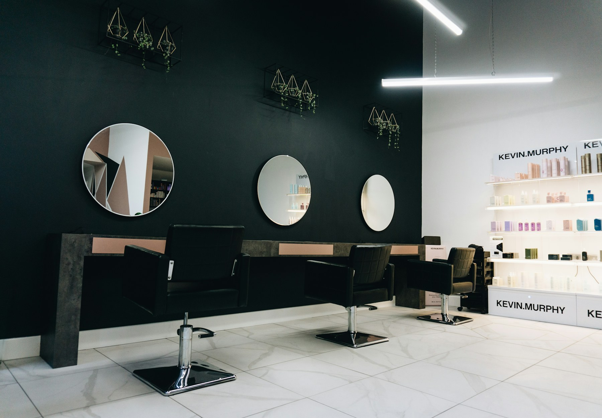

Ještě před patnácti lety by většina mužů v Česku zašla prostě „ke kadeřnici“. Dnes mají na výběr mezi klasickým kadeřnictvím, unisex salonem a barbershopem. Hranice mezi nimi nejsou ostré, přesto se v něčem liší.

## Co je barbershop

Barbershop navazuje na tradici holičství. Specializuje se na **pánské střihy a péči o vousy**: zastřihování a tvarování vousů, holení břitvou, horký ručník. Typické jsou krátké střihy s plynulým přechodem do ztracena (fade), práce se strojkem a precizní kontury.

K barbershopu obvykle patří i atmosféra: pánské prostředí, kafe nebo pivo během čekání, často online rezervace na konkrétního barbera.

## Co je kadeřnictví

Kadeřnictví stříhá dámy, pány i děti a kromě střihu nabízí **barvení, melíry, trvalou, foukanou nebo společenské účesy**. Pánské kadeřnictví zvládne běžné pánské střihy, holení a úpravu vousů ale nabízí jen některá.

Pro delší pánské vlasy, barvení nebo když chcete stříhat celou rodinu na jednom místě, je kadeřnictví praktičtější volba.

## Kam tedy zajít?

- **Krátký střih s fadem, ostré kontury, úprava vousů** → barbershop.
- **Delší vlasy, barvení, melír, dámský nebo dětský střih** → kadeřnictví.
- **Klasický pánský střih bez speciálních požadavků** → obojí, rozhodne spíš cena, vzdálenost a volný termín.

## Na co se dívat při výběru

Ať už vybíráte barbershop, nebo kadeřnictví, vyplatí se:

1. **Prohlédnout si ukázky práce.** Většina salonů má Instagram nebo Facebook s fotkami střihů.
2. **Zjistit, jestli se objednává předem.** Barbershopy často pracují jen na rezervace, některá kadeřnictví berou i zákazníky z ulice.
3. **Ověřit otevírací dobu.** Hlavně o víkendu a ve svátky se liší.

V našem katalogu u každého salonu najdete typ provozovny, kontakt a otevírací dobu, pokud ji známe. Stačí [vyhledat své město](/).

## Barbershop a kadeřnictví v číslech

V katalogu evidujeme **297 barbershopů**, u 112 z nich známe otevírací dobu. Ve srovnání s klasickými kadeřnictvími mají barbershopy otevřeno déle a víc přizpůsobeně lidem, kteří pracují:

| | Barbershopy | Kadeřnictví |
|---|---|---|
| Otevřeno v sobotu | 61 % | 38 % |
| Otevřeno večer do 19:00 a déle | 76 % | 54 % |
| Typicky hodin týdně | 57 | 51 |

Když tedy potřebujete pánský střih v sobotu nebo pozdě večer, máte u barbera zhruba o polovinu větší šanci. Pro dámské střihy, barvení a dětské střihy zůstává jistější klasické kadeřnictví.

Barbershopy podle města: [Brno](/barbershopy/brno/), [Praha 5](/barbershopy/praha-5/), [Praha 3](/barbershopy/praha-3/), [Praha 6](/barbershopy/praha-6/). Kadeřnictví s pánskými střihy najdete ve výběru [pánská kadeřnictví](/panska-kadernictvi/brno/).

Data jsou z našeho katalogu ke 7. 11. 2026 a vychází z 579 salonů, u kterých známe otevírací dobu.
