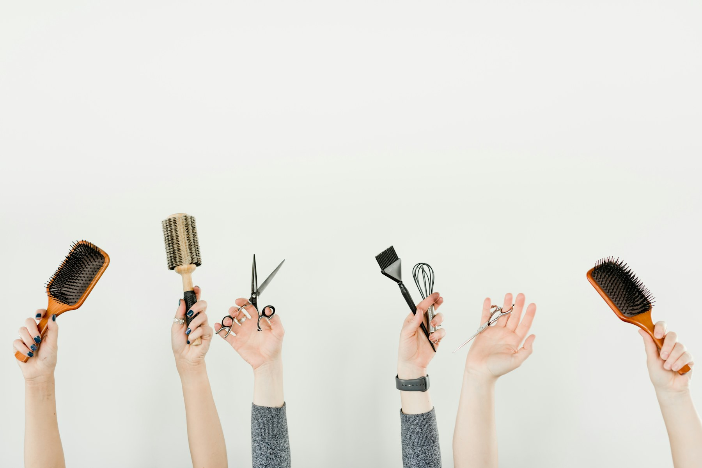

Barvení vlasů má desítky názvů a variant a v každém salonu mohou pod stejným slovem myslet trochu něco jiného. Proto se vyplatí znát základní principy a na konzultaci vždy ukázat fotku.

## Celobarva

Barva se nanáší **na všechny vlasy od kořínků po konečky**. Výsledkem je jednotný odstín. Hodí se pro zakrytí šedin nebo výraznou změnu barvy.

**Údržba:** odrosty jsou vidět po 4 až 6 týdnech, pak se barví jen kořínky.

## Melír

Zesvětlují se **jednotlivé pramínky od kořínků**, nejčastěji pomocí fólií. Pramínky mohou být jemné (přirozený efekt) nebo výraznější (kontrast).

**Údržba:** odrosty jsou viditelné, obnova zhruba po 8 až 12 týdnech.

## Balayage

Barva se **maluje volně rukou** na povrch pramenů, bez fólií nebo jen s jejich částečným použitím. Zesvětlení je měkké a nepravidelné, jako by vlasy vybledly sluncem. Kořínky zůstávají přirozené.

**Údržba:** díky měkkému přechodu nevznikají ostré odrosty. Obnova stačí po **3 až 4 měsících**.

## Ombré

Výrazný **přechod od tmavších kořínků do světlejších délek**. Na rozdíl od balayage je přechod vodorovný a jasně viditelný.

**Sombré** („soft ombré“) je jemnější verze s menším kontrastem a plynulejším přechodem.

## Tónování

Tónování **nemění výrazně světlost vlasů**, ale upravuje jejich odstín: zjemní žluté tóny po zesvětlení, dodá lesk nebo osvěží vybledlou barvu. Často se dělá jako doplněk k melíru nebo balayage.

## Co si objednat

| Chci… | Technika |
| --- | --- |
| zakrýt šediny, jednotnou barvu | celobarva |
| přirozeně prosvětlit vlasy | jemný melír, balayage |
| co nejméně chodit do salonu | balayage, sombré |
| výrazný efekt světlých konců | ombré |
| zrušit žlutý nádech blond | tónování |

## Na co se připravit

- **Zesvětlování trvá.** Balayage nebo melír na dlouhých vlasech zabere klidně tři hodiny i víc.
- **Výrazná změna se někdy dělá na více návštěv**, aby se vlasy nepoškodily.
- **Řekněte o předchozím barvení**, i domácím. Ovlivňuje, jak barva chytne.

Po barvení vlasy potřebují jinou péči než dřív. Podívejte se na [tipy, jak pečovat o barvené vlasy](/blog/pece-o-barvene-vlasy/).
