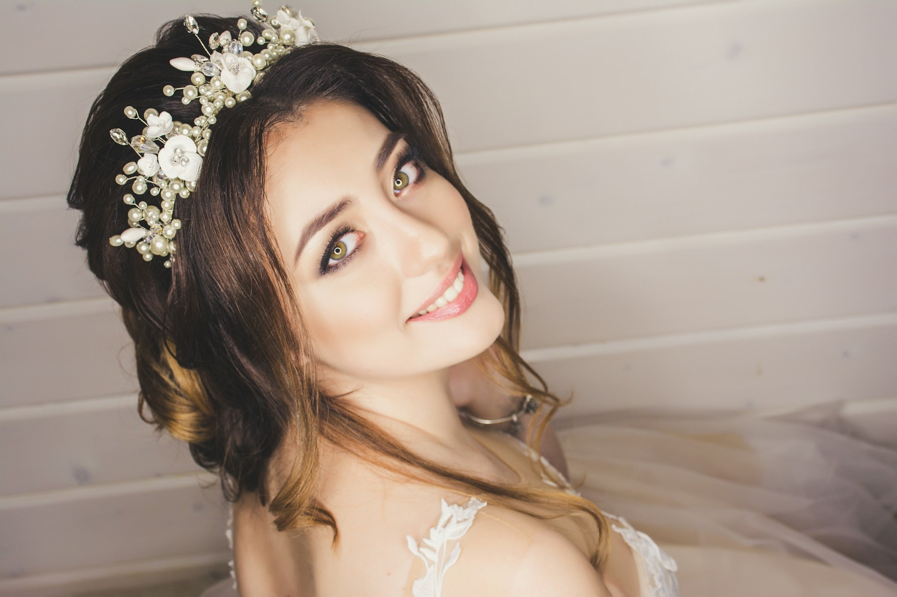

Dobrý střih je ten, který vám sedí a zvládnete ho doma upravit za pár minut. Záleží na tvaru obličeje, na tom, jak husté a silné vlasy máte, a na tom, kolik času jim chcete ráno věnovat. Průvodce začíná výběrem střihu, pokračuje jemnými vlasy a rychlými účesy a končí svatebním účesem, který je potřeba řešit s předstihem.

## Střih podle tvaru obličeje

Dobrý střih umí obličej opticky protáhnout, zjemnit nebo zvýraznit to hezké. Kadeřnice to obvykle odhadne sama, ale když víte, s čím přicházíte, snáz se domluvíte.

### Jak zjistit tvar obličeje

Stáhněte vlasy dozadu, postavte se před zrcadlo a všimněte si tří věcí:

1. **Kde je obličej nejširší:** čelo, lícní kosti, nebo čelist?
2. **Jaký je poměr délky a šířky:** je obličej spíš dlouhý, nebo stejně dlouhý jako široký?
3. **Jaká je linie brady:** kulatá, hranatá, nebo špičatá?

### Oválný obličej

Délka je o něco větší než šířka, čelo je o něco širší než brada, linie jsou měkké. **Sluší mu skoro všechno**, od pixie po dlouhé vlny. Pozor jen na hustou rovnou ofinu, která obličej zbytečně zkrátí.

### Kulatý obličej

Šířka a délka jsou podobné, tváře plné, brada zaoblená. Cílem je obličej opticky protáhnout:

- **střihy s objemem nahoře** a hladšími stranami,
- **asymetrický bob** nebo lob končící pod bradou,
- **dlouhá šikmá ofina** místo rovné.

Méně vhodné jsou bradou zakončené rovné bobi a objem v úrovni tváří.

### Hranatý obličej

Výrazná čelist, čelo a čelist zhruba stejně široké. Vhodné jsou **měkké linie a vlny**, které hranatost zjemní:

- vrstvené střihy po ramena a delší,
- vlny a lehké kudrny kolem obličeje,
- **ofina na stranu**.

Ostré, rovné linie v úrovni čelisti hranatost spíš zvýrazní.

### Srdcový obličej

Širší čelo a lícní kosti, užší špičatá brada. Cílem je přidat objem dolů:

- **bob nebo lob končící pod bradou**,
- vlny od úrovně brady dolů,
- **záclonková ofina** (curtain bangs), která opticky zúží čelo.

### Protáhlý obličej

Obličej je výrazně delší než širší. Pomáhá vše, co přidá šířku:

- **rovná nebo záclonková ofina**, která zkrátí čelo,
- objem po stranách, vlny,
- **bob nebo střední délka**. Velmi dlouhé rovné vlasy obličej ještě protáhnou.

### Nejen tvar obličeje

Tvar obličeje je jen jedna z věcí, které kadeřnice zvažuje. Stejně důležitá je **struktura vlasů** (jemné, husté, vlnité), **čas, který chcete věnovat úpravě**, a váš styl. Krátký střih, který vyžaduje každé ráno fénování, nebude dobrá volba, pokud se chcete jen učesat a jít.

## Střihy pro jemné vlasy

Jemné vlasy mají tenký průměr jednotlivého vlasu, řídké vlasy jich mají na hlavě méně. Často se to kombinuje. Obojí má stejný problém: vlasy působí ploše a ztrácí tvar. Klíčem je délka a tvar konečků.

### Nejlepší střihy

- **Bob (mikádo) po bradu.** Rovně střižené konečky vytvoří hustou linku, vlasy působí plnější. Nejjistější volba pro jemné vlasy.
- **Lob (dlouhý bob) po ramena.** Pro ty, kdo nechtějí jít nakrátko. Stále dost krátký, aby vlasy nesplihly vlastní vahou.
- **Pixie.** Velmi krátký střih s texturou nahoře. Objem je snadný, odvážnější varianta.
- **Jemné vrstvy, ne příliš.** Pár delších vrstev kolem obličeje dodá pohyb. Mnoho krátkých vrstev ale jemné vlasy ještě víc „zředí“.
- **Ofina.** Rovná nebo záclonková ofina zaplní prostor kolem obličeje a vlasy působí hustší.

Co vybrat podle tvaru obličeje, najdete v první části tohoto průvodce.

### Čemu se vyhnout

- **Velmi dlouhé vlasy jedné délky.** Konečky se ztenčují a vlasy působí řídce.
- **Silné prostříhávání (ztenčování).** U jemných vlasů ubírá na hustotě, která tam už tak chybí.
- **Těžké masky a oleje ke kořínkům.** Vlasy zatíží a rychleji se mastí.

### Styling pro objem

1. **Objemový šampon a lehký kondicionér** jen do délek.
2. **Pěna nebo sprej pro objem** ke kořínkům do vlhkých vlasů.
3. **Fénování hlavou dolů** a s kulatým kartáčem u kořínků, viz [Fénování doma](/blog/pece-o-vlasy-doma/).
4. **Suchý šampon** i na čisté vlasy: dodá kořínkům texturu a objem.
5. **Změna pěšinky.** Přehození pěšinky na druhou stranu zvedne vlasy u kořínků.

### Barva jako optický trik

Jemné prameny melíru nebo balayage vytvoří světlo a stín, vlasy pak působí hustší než při jednolité barvě. Více v průvodci [barvení, trvalá, keratin a prodlužování](/blog/salonni-sluzby-pro-zeny/).

## Rychlé účesy na každý den

Rozpuštěné vlasy nejsou vždycky praktické a dlouhé fénování ráno nestíháme. Tyhle účesy vypadají upraveně a zvládnete je za pár minut.

### 1. Nízký uhlazený drdol

Elegantní a nadčasový, hodí se do práce i na večer.

1. Vlasy učešte dozadu a stáhněte gumičkou v týle.
2. Culík otočte kolem gumičky do drdolu.
3. Zajistěte sponkami a uhlaďte trochou vosku nebo laku.

**Tip:** pro uvolněnější verzi z drdolu na závěr lehce vytáhněte pár pramínků.

### 2. Francouzský cop

Drží celý den a hodí se i na sport.

1. Na temeni vezměte pramen a rozdělte ho na tři části.
2. Pleťte jako běžný cop, ale při každém překřížení přidejte k pramenu vlasy ze strany.
3. Až vám dojdou vlasy u týla, dopleťte běžný cop a zajistěte gumičkou.

**Varianta:** holandský cop, kdy pramínky křížíte pod sebou, takže cop vystoupí nad vlasy.

### 3. Polovyčesané vlasy

Ideální, když chcete mít vlasy rozpuštěné, ale ne v obličeji.

1. Vezměte horní část vlasů od spánků po temeno.
2. Stáhněte gumičkou nebo sponou, případně stočte do malého drdolu.

### 4. Uzlový culík

Obyčejný culík s detailem navíc.

1. Udělejte culík.
2. Spodní pramínek z culíku omotejte kolem gumičky a zajistěte sponkou.

Gumička zmizí a culík působí upraveněji.

### 5. Velký volný cop

Moderní, trochu rozcuchaný cop na stranu.

1. Vlasy přehoďte na jedno rameno.
2. Zapleťte volný cop a zajistěte gumičkou.
3. Prsty jednotlivé „články“ copu povytáhněte, aby byl objemnější.

### Co se hodí mít po ruce

- gumičky bez kovu, které netrhají vlasy,
- sponky v barvě vlasů,
- suchý šampon pro objem u kořínků,
- vosk nebo lak na zkrocení odstávajících vlasů.

## Svatební účes

Zatímco šaty se vybírají měsíce dopředu, na účes se často myslí až na poslední chvíli. Přitom dobré kadeřnice mívají svatební sezónu obsazenou daleko dopředu.

### Časový plán

| Kdy | Co udělat |
| --- | --- |
| 6–9 měsíců předem | vybrat kadeřnici a zarezervovat termín |
| 3–4 měsíce předem | střih a případné barvení, ať vlasy stihnou dorůst do tvaru |
| 1–2 měsíce předem | zkouška účesu |
| 2–3 týdny předem | poslední úprava barvy |
| týden předem | zastřižení konečků, ne nový střih |

### Výběr kadeřnice

- **Podívejte se na ukázky svatebních účesů**, ne jen běžné práce.
- **Zjistěte, jestli dojíždí na místo.** Na svatbu se obvykle chystá doma nebo v místě obřadu.
- **Domluvte se na počtu účesů.** Pokud se chystá i maminka nebo družičky, kadeřnice musí počítat s časem.

### Zkouška účesu nevynechávejte

Na zkoušce se ukáže, jestli účes sedí k obličeji, šatům i závoji a jak dlouho vydrží. Přineste:

- **fotky účesů**, které se vám líbí,
- **fotku šatů** (hlavně výstřih a záda),
- **závoj, čelenku nebo ozdoby** do vlasů,
- triko, které jde svléknout přes hlavu bez poničení účesu.

Po zkoušce si účes nechte celý den a vyfoťte ho z různých úhlů. Uvidíte, jak drží a jak vypadá na fotkách.

### Účes podle šatů

- **Hluboký výstřih na zádech** vynikne s vyčesaným drdolem.
- **Šaty s krajkou u krku** se hodí k jednoduššímu účesu, aby nesoupeřily.
- **Šaty bez ramínek** dobře doplní rozpuštěné vlny nebo polovyčesaný účes.
- **Dlouhý závoj** potřebuje pevný základ v účesu, ke kterému se připne.

### V den svatby

1. **Vlasy umyjte večer předem**, pokud kadeřnice neřekne jinak. Úplně čisté vlasy hůř drží.
2. **Žádné nové přípravky** ani masky těsně před svatbou.
3. **Počítejte s časem.** Svatební účes trvá klidně hodinu a půl.
4. **Mějte po ruce sponky a lak** na případné opravy během dne.

## Než půjdete ke kadeřnici

Přineste si 2 až 3 fotky účesů, které se vám líbí, a jednu, která se vám nelíbí. Řekněte, kolik času ráno vlasům dáte. Víc rad k první návštěvě najdete v článku [jak vybrat kadeřníka](/blog/jak-vybrat-kadernika/). Salony s dámskými střihy najdete podle města, například v [Brně](/damska-kadernictvi/brno/) nebo [Praze 9](/damska-kadernictvi/praha-9/), případně [podle polohy](/okoli/).
