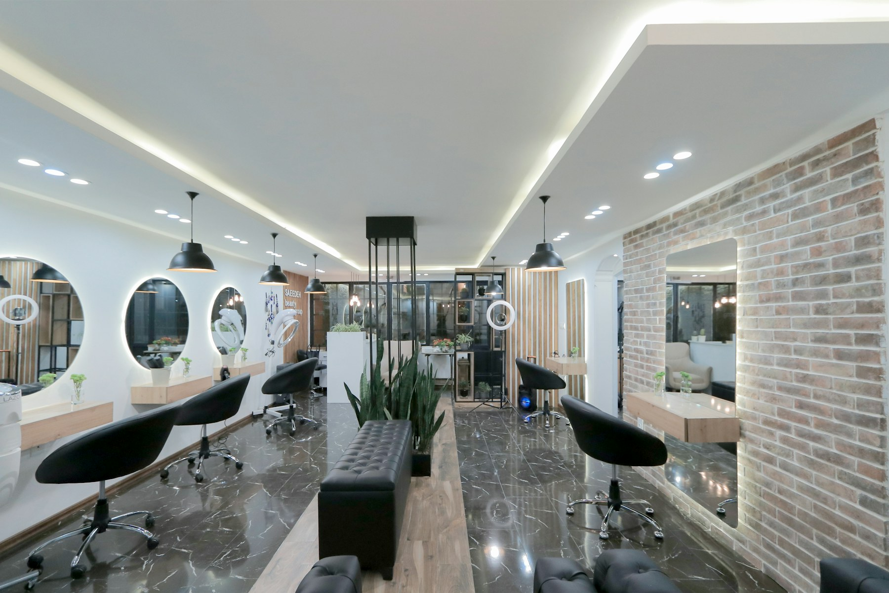

Najít kadeřníka, kterému můžete věřit, chvíli trvá. Pár jednoduchých kroků ale ušetří zklamání i peníze.

## 1. Začněte v okolí

Kadeřnictví by mělo být dostupné. Pokud se má z návštěvy stát pravidelná rutina, je praktické mít salon blízko domova nebo práce. V katalogu si můžete zobrazit [salony podle města](/) a u každého z nich vidíte i další provozovny v okolí.

## 2. Podívejte se na ukázky práce

Fotky střihů na Instagramu nebo Facebooku řeknou víc než popis. Všímejte si, jestli salon ukazuje práci podobnou té, kterou chcete vy: krátké pánské střihy, barvení, dlouhé vlasy, kudrnaté vlasy.

## 3. Zeptejte se známých

Doporučení od lidí, jejichž účes se vám líbí, je pořád nejspolehlivější zdroj. Klidně se zeptejte, kam chodí.

## 4. Začněte jednodušší službou

Pokud salon neznáte, nemusíte hned objednávat barvení. Zkuste nejdřív střih nebo úpravu a uvidíte, jak kadeřník komunikuje a jak pracuje.

## 5. Sledujte, jestli se ptá

Dobrý kadeřník nebo barber se na začátku zeptá: jak vlasy nosíte, jak často chodíte stříhat, kolik času věnujete úpravě. Pokud začne stříhat bez otázek, je to varovný signál.

## 6. Nebojte se říct, co chcete

Přineste si fotku účesu, který se vám líbí. Je to rychlejší a přesnější než popis slovy. A když se vám něco nelíbí, řekněte to hned, dokud se to dá napravit.

## Kdy hledat jinde

Změnit salon stojí za to, když se opakovaně nedodržují termíny, výsledek neodpovídá domluvě nebo se necítíte příjemně. Kadeřnictví je služba, ve které hraje velkou roli důvěra.

## Jak se připravit na návštěvu

Návštěva kadeřnictví nemusí být loterie. Když si předem ujasníte pár věcí, kadeřník nebo barber přesně ví, co od něj čekáte.

### Objednejte se včas

Hlavně v pátek a v sobotu bývají termíny obsazené několik dní dopředu. Při objednání řekněte, o jakou službu jde: střih, barvení, úprava vousů. Podle toho salon počítá s časem.

Telefon a otevírací dobu najdete u každého salonu v našem katalogu.

### Mýt, nebo nemýt?

Běžné pravidlo: na střih přijďte s čistými vlasy bez silné vrstvy stylingových přípravků. **Před barvením** naopak některé salony doporučují vlasy den předem nemýt, protože přirozený maz chrání pokožku. Když si nejste jistí, zeptejte se při objednání.

### Připravte si fotku

Fotka účesu, který se vám líbí, je nejlepší zadání. Pokud máte i fotku toho, co se vám **nelíbí**, ukažte ji taky, i to hodně pomůže.

### Řekněte, jak vlasy nosíte

Kadeřníka zajímá:

- jak dlouho si vlasy ráno upravujete,
- jestli používáte fén, žehličku nebo stylingové přípravky,
- jak často chodíte stříhat.

Podle toho zvolí střih, který bude vypadat dobře i doma, ne jen v salonu.

### U barbera mluvte i o vousech

Pokud si necháváte upravovat vousy, řekněte, jakou délku a tvar chcete a jestli si je mezi návštěvami zastřihujete sami.

### Po návštěvě

Zeptejte se, jak účes udržovat a za jak dlouho přijít znovu. Pokud jste spokojení, objednejte se rovnou na další termín, ušetříte si shánění.

## Dýško u kadeřníka: kolik a kdy

Spropitné u kadeřníka není v Česku povinné ani automatické. Přesto ho většina kadeřníků a barberů od spokojených zákazníků čas od času dostane a potěší je.

### Kolik se obvykle dává

Podle zkušeností kadeřníků, které popsal [server Energozrouti.cz](https://energozrouti.cz/clanek/kadernik-otevrene-promluvil-o-spropitnem-od-cechu), se nejčastěji nechává **50–100 Kč**, případně se částka zaokrouhlí nahoru, třeba z 910 na 1 000 Kč. Výjimkou nejsou ani dvacetikoruny, vyšší dýška kolem dvou set korun jsou spíš vzácná.

Jako rozumné vodítko poslouží stejné pravidlo jako v restauraci: **zhruba 5–10 % z ceny**, pokud jste spokojení. U drahých služeb, jako je barvení nebo melír za několik tisíc, lidé obvykle volí pevnou částku, ne procenta.

### Kdy dýško dává smysl

- Kadeřník si dal záležet, poradil vám a výsledek se povedl.
- Vešel vás „mezi“ termíny nebo zůstal déle kvůli vám.
- Chodíte pravidelně a chcete poděkovat, třeba před Vánoci.

### Kdy ho nedávat

Pokud jste spokojení nebyli, spropitné nedávejte. Lepší je ale říct na místě, co se vám nelíbí. Většina kadeřníků drobnosti hned upraví. Je to užitečnější než mlčky odejít.

### Majitel salonu a dýško

Dříve platilo nepsané pravidlo, že se majiteli salonu dýško nedává, protože si cenu určuje sám. Dnes to tak striktní není. Mnoho salonů vede živnostník, který si sám stříhá, a poděkování ocení stejně jako zaměstnanec.

### Placení kartou

Pokud platíte kartou, řekněte částku i se spropitným ještě předtím, než kadeřník zadá platbu do terminálu: „Udělejte to prosím za 700.“ Některé terminály nabízejí dýško přímo na displeji. Pokud chcete, aby šlo konkrétnímu kadeřníkovi, je jistější nechat ho v hotovosti.
