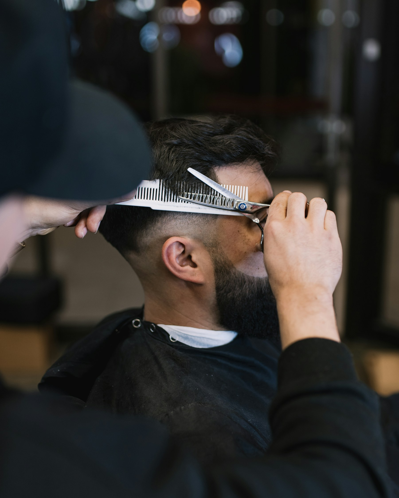

Kdo někdy seděl v křesle a na otázku „Tak co to bude?“ odpověděl „Nějak kratší“, ví, že výsledek může dopadnout všelijak. Znát pár základních pojmů pomáhá: barber přesně pochopí, co chcete, a vy víte, co čekat.

## Fade (přechod do ztracena)

Fade je **plynulý přechod od velmi krátkých vlasů na spánku a v týle k delším vlasům nahoře**. Dělá se strojkem s postupně se zvětšujícími nástavci a výsledkem je čistý, upravený vzhled.

Podle toho, kde přechod začíná, se rozlišuje:

- **Low fade:** přechod začíná nízko, těsně nad ušima. Decentní a vhodný i do kanceláře.
- **Mid fade:** začíná zhruba ve výšce spánků. Univerzální volba.
- **High fade:** začíná vysoko, strany jsou téměř vyholené. Výrazný, sportovní vzhled.
- **Skin fade (bald fade):** spodní část jde až na kůži.

**Údržba:** fade „vyroste“ rychle, ostrý vzhled vydrží zhruba dva až tři týdny.

## Undercut

U undercutu jsou **strany a zadní část zkrácené na jednu délku** a vlasy nahoře zůstávají výrazně delší, bez plynulého přechodu. Mezi krátkými a dlouhými vlasy je tak vidět ostrá hranice.

Undercut se dá česat dozadu, na stranu i nahoru. Hodí se pro hustší vlasy, které drží tvar.

## Crop (French crop)

Krátké vlasy nahoře sčesané dopředu s **rovnou nebo lehce roztřepenou ofinou**, strany obvykle ve fade. Je to praktický střih, který skoro nevyžaduje styling, a dobře skryje i ustupující vlasovou linii.

## Buzz cut

Nejjednodušší možný střih: **celá hlava strojkem na jednu krátkou délku**. Hodí se pro muže s pravidelným tvarem hlavy a pro ty, kdo nechtějí řešit úpravu. Varianta s krátkým fade po stranách vypadá upraveněji.

## Crew cut

Klasika: nahoře o něco delší vlasy (zhruba na šířku prstu), strany a týl kratší. Je nadčasový, sluší většině mužů a nevyžaduje skoro žádnou péči.

## Pompadour a quiff

Objemové účesy s **delšími vlasy nahoře vyčesanými nahoru a dozadu**. Pompadour je uhlazenější a vyšší, quiff volnější a rozcuchanější. Potřebují husté vlasy, fén a stylingový přípravek (pomádu nebo hlínu) a každé ráno pár minut práce.

## Textured top

Nahoře střední délka vlasů s **viditelnou texturou**, kterou barber vytvoří efilačními nůžkami nebo břitvou. Vypadá přirozeně a „neučesaně“, stačí trocha matného přípravku.

## Jak si střih správně objednat

1. **Přineste fotku.** Nejrychlejší a nejpřesnější cesta. Ideálně fotku zepředu i z boku.
2. **Řekněte délku nástavce, pokud ji znáte.** Strojky mají nástavce v milimetrech nebo číslech (např. „po stranách trojku, nahoře nůžkami“).
3. **Popište, jak vlasy nosíte.** Jestli je češete, nebo jen prohrábnete rukou.
4. **Zmiňte vousy.** Pokud je nosíte, barber přechod mezi vlasy a vousy sladí.

## Jak často chodit stříhat

Krátké střihy s fade potřebují úpravu nejčastěji, zhruba každé dva až čtyři týdny. Delší střihy jako pompadour nebo textured top vydrží čtyři až šest týdnů.

Hledáte barbera ve svém okolí? Použijte [vyhledávání podle polohy](/okoli/) nebo si projděte [barbershopy podle města](/).
