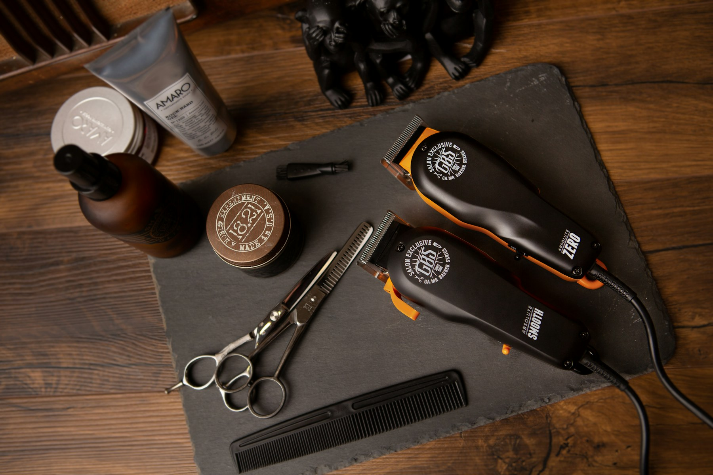

Vousy rostou každý den a každý den na ně působí jídlo, prach i suchý vzduch. Barber jim dá tvar, ale aby dobře vypadaly i za dva týdny, potřebují doma pár minut péče.

## Mytí: méně je víc

Vousy myjte **dvakrát až třikrát týdně speciálním šamponem na vousy** nebo jemným šamponem na vlasy. Běžné mýdlo a sprchový gel vousy i kůži pod nimi vysušují, což vede ke svědění a lupům.

Ve dnech mezi mytím stačí opláchnout vodou. Po umytí vousy jemně vysušte ručníkem: netřete, spíš přitiskněte.

## Olej a balzám

- **Vousový olej** změkčuje chlupy a hlavně pečuje o kůži pod nimi. Nanášejte pár kapek na vlhké vousy, vmasírujte až ke kůži a pročešte.
- **Balzám** má hustší konzistenci, vousy lehce zafixuje a zkrotí odstávající chlupy. Hodí se pro delší vousy.

U krátkého strniště stačí olej, u delších vousů se vyplatí kombinace obou.

## Zastřihování doma

Na údržbu mezi návštěvami barbera stačí **zastřihovač s nástavci** a malé nůžky.

1. **Stříhejte suché vousy.** Mokré jsou delší a snadno uberete víc, než chcete.
2. **Začněte s delším nástavcem.** Kratší můžete nasadit vždycky, delší vousy zpátky nedostanete.
3. **Stříhejte po směru růstu**, u krku a na lících proti směru jen opatrně.
4. **Kontrolujte symetrii** v zrcadle zepředu, ne jen z boku.

## Kontury: krk a líce

Nejvíc na upraveném vzhledu dělají čisté linie.

- **Linie na krku:** představte si oblouk zhruba dva prsty nad ohryzkem, od ucha k uchu. Vše pod ním odstraňte. Příliš vysoká linie vousy opticky zmenší a zvýrazní bradu.
- **Linie na lících:** nechte ji co nejpřirozenější, jen odstraňte zatoulané chlupy nad ní.

Pokud si kontury netroufnete udělat sami, nechte je barberovi. Ostrý tvar pak doma jen udržujete.

## Jak často k barberovi

Krátké a střední vousy se vyplatí nechat profesionálně upravit **jednou za tři až pět týdnů**, ideálně spolu se střihem vlasů. Barber sladí délku vousů s účesem a obnoví kontury.

## Časté chyby

- **Příliš časté mytí** obyčejným šamponem: suché vousy a lupy.
- **Zastřihování bez hřebene:** vousy se pak stříhají nerovnoměrně.
- **Zanedbaný knír:** přesahující chlupy přes horní ret působí neupraveně, zastřihněte je nůžkami.

Hledáte barbershop s úpravou vousů? [Najděte barbera ve svém okolí](/okoli/).

## Kdy zajít k barberovi

Kontury vousů vydrží zhruba 2 až 3 týdny, pak je vidět, že dorůstají. Pokud se o vousy staráte doma, stačí k barberovi jednou za měsíc na srovnání tvaru, s krátkými vousy a ostrou linkou častěji.

Barbershopy mají otevřeno déle než běžná kadeřnictví: 72 % z nich má aspoň jeden všední den otevřeno do 19:00 a 57 % v sobotu (podle otevírací doby 135 barbershopů v našem katalogu). Úprava vousů trvá kolem 30 minut, takže se dá stihnout i cestou z práce.

Barbershopy podle města najdete třeba v [Brně](/barbershopy/brno/), v [Praze 5](/barbershopy/praha-5/) nebo v [Praze 6](/barbershopy/praha-6/). Při objednání se zeptejte, jestli dělají i holení břitvou s horkým ručníkem, ne každý barber ho nabízí.
