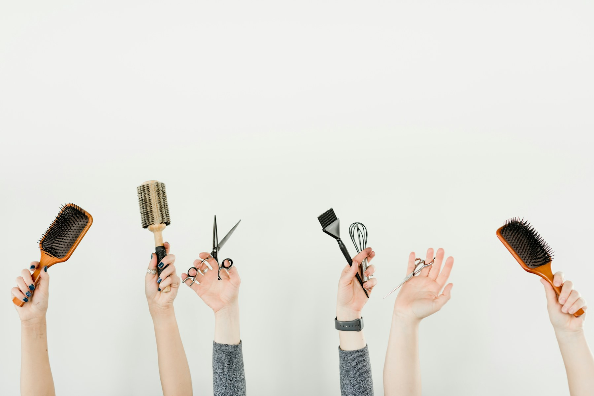

Střih zvládne skoro každý salon. U barvení, trvalé, keratinu a prodlužování je to jinak: výsledek víc závisí na zkušenosti kadeřnice, služba trvá hodiny a chyba se opravuje těžko. V tomhle přehledu najdete, jak jednotlivé služby probíhají, jak dlouho vydrží a na co se zeptat předem.

Obecné pravidlo pro všechny: **domluvte si nejdřív konzultaci**. Dobrá kadeřnice se podívá na stav vlasů, zeptá se na předchozí barvení a řekne, co je reálné.

## Barvení: melír, balayage, ombré

Barvení vlasů má desítky názvů a variant a v každém salonu mohou pod stejným slovem myslet trochu něco jiného. Proto se vyplatí znát základní principy a na konzultaci vždy ukázat fotku.

### Celobarva

Barva se nanáší **na všechny vlasy od kořínků po konečky**. Výsledkem je jednotný odstín. Hodí se pro zakrytí šedin nebo výraznou změnu barvy.

**Údržba:** odrosty jsou vidět po 4 až 6 týdnech, pak se barví jen kořínky.

### Melír

Zesvětlují se **jednotlivé pramínky od kořínků**, nejčastěji pomocí fólií. Pramínky mohou být jemné (přirozený efekt) nebo výraznější (kontrast).

**Údržba:** odrosty jsou viditelné, obnova zhruba po 8 až 12 týdnech.

### Balayage

Barva se **maluje volně rukou** na povrch pramenů, bez fólií nebo jen s jejich částečným použitím. Zesvětlení je měkké a nepravidelné, jako by vlasy vybledly sluncem. Kořínky zůstávají přirozené.

**Údržba:** díky měkkému přechodu nevznikají ostré odrosty. Obnova stačí po **3 až 4 měsících**.

### Ombré

Výrazný **přechod od tmavších kořínků do světlejších délek**. Na rozdíl od balayage je přechod vodorovný a jasně viditelný.

**Sombré** („soft ombré“) je jemnější verze s menším kontrastem a plynulejším přechodem.

### Tónování

Tónování **nemění výrazně světlost vlasů**, ale upravuje jejich odstín: zjemní žluté tóny po zesvětlení, dodá lesk nebo osvěží vybledlou barvu. Často se dělá jako doplněk k melíru nebo balayage.

### Co si objednat

| Chci… | Technika |
| --- | --- |
| zakrýt šediny, jednotnou barvu | celobarva |
| přirozeně prosvětlit vlasy | jemný melír, balayage |
| co nejméně chodit do salonu | balayage, sombré |
| výrazný efekt světlých konců | ombré |
| zrušit žlutý nádech blond | tónování |

### Na co se připravit

- **Zesvětlování trvá.** Balayage nebo melír na dlouhých vlasech zabere klidně tři hodiny i víc.
- **Výrazná změna se někdy dělá na více návštěv**, aby se vlasy nepoškodily.
- **Řekněte o předchozím barvení**, i domácím. Ovlivňuje, jak barva chytne.

## Trvalá

Trvalá změní strukturu vlasu chemicky: přípravek naruší vazby uvnitř vlasu, vlasy se natočí na natáčky a fixáž vazby znovu „zamkne“ v novém tvaru. Výsledek vydrží, dokud vlasy neodrostou nebo se neostříhají.

### Druhy trvalé

- **Klasická trvalá na natáčky.** Pravidelné kudrny, jejichž velikost určuje průměr natáček. Čím větší natáčky, tím volnější vlny.
- **Beach waves a volná trvalá.** Velké natáčky nebo spirály dávají volné vlny, které působí, jako by vlasy uschly po moři. Dnes nejžádanější varianta.
- **Spirálová trvalá.** Hlavně pro delší vlasy, kudrny jsou protáhlé a pružné.
- **Objemová trvalá ke kořínkům.** Natočí se jen část u kořínků, vlasy získají objem bez viditelných vln.
- **Pánská trvalá.** U kratších vlasů vytvoří texturu a lehké vlny nahoře, často v kombinaci s fadem na bocích.

### Jak probíhá

Návštěva trvá obvykle 2–3 hodiny podle délky vlasů. Kadeřnice vlasy umyje, natočí, nanese přípravek, po působení vlasy neutralizuje fixáží a nakonec upraví. Na konzultaci se vyplatí přinést fotku vln, které se vám líbí.

### Jak dlouho vydrží

Natočená část vlasu zůstane zvlněná, dokud ji neodstřihnete. Většina lidí trvalou obnovuje po 3–6 měsících, když odrostlé rovné kořínky začnou být vidět. Tvar se postupně uvolňuje, takže vlny bývají nejvýraznější první týdny.

### Péče po trvalé

- První 2–3 dny vlasy **nemyjte a nesvazujte** do pevného culíku. Vazby se teprve stabilizují.
- Používejte **šampon bez silikonů a sulfátů** a kondicionér na kudrnaté vlasy.
- **Nečesejte nasucho** kartáčem, kudrny se rozčešou do nadýchaného chuchvalce. Rozčesávejte prsty nebo řídkým hřebenem ve vlhku.
- Fén s **difuzérem** vlny zvýrazní, viz [Fénování doma](/blog/pece-o-vlasy-doma/). Více tipů v článku o [kudrnatých vlasech](/blog/pece-o-vlasy-doma/).

### Kdy trvalou nedělat

Pokud jsou vlasy hodně poškozené, třeba po opakovaném odbarvování, chemický proces je může dál oslabit. Hned po barvení nebo po keratinovém narovnání (viz níže) je lepší pár týdnů počkat. Dobrá kadeřnice vlasy před trvalou posoudí a případně doporučí test na jednom prameni.

## Keratinové narovnání

Keratinové narovnání (často se mu říká i brazilské) je salonní ošetření, které vlasy uhladí, zkrotí krepatění a zkrátí fénování. Na rozdíl od trvalého chemického narovnání vlasy úplně nenarovná, spíš je zjemní a uhladí.

### Jak to probíhá

1. Vlasy se umyjí speciálním šamponem, který otevře jejich povrch.
2. Na vlasy se nanese přípravek s keratinem a dalšími látkami.
3. Vlasy se vyfénují a pramen po pramenu přežehlí horkou žehličkou. Teplo přípravek ve vlasech „zapečetí“.

Podle délky a hustoty vlasů trvá ošetření 2–4 hodiny. Cena se odvíjí hlavně od délky vlasů a spotřeby přípravku, obvykle jde o tisíce korun.

### Jak dlouho vydrží

Účinek se postupně vymývá, obvykle vydrží **2–5 měsíců**. Záleží na struktuře vlasů, četnosti mytí a použitém šamponu. Odrostlé vlasy u kořínků ošetřené nejsou.

### Na co si dát pozor

- **Složení přípravku.** Některé přípravky na narovnání mohou při zahřívání uvolňovat formaldehyd, který dráždí oči a dýchací cesty. Zeptejte se, jaký přípravek salon používá, a zda je bez formaldehydu a látek, které ho uvolňují. Salon by měl být dobře větraný.
- **Těhotenství a kojení.** Většina výrobců i kadeřníků v této době ošetření nedoporučuje. Pokud si nejste jistí, poraďte se s lékařem.
- **Barvení.** Barvit je lepší **před** ošetřením, ne těsně po něm. Keratin by barvu uzavřel, ale barva by mohla ošetření narušit.
- **Objem.** Vlasy jsou po ošetření hladší a „těžší“. Pokud máte jemné vlasy a chcete objem, nemusí být keratin dobrá volba, viz [střihy pro jemné vlasy](/blog/damske-strihy-a-ucesy/).

### Péče po ošetření

- První **2–3 dny** vlasy nemyjte, nesvazujte gumičkou ani nezastrkávejte za uši (podle doporučení salonu).
- Používejte **šampon bez sulfátů** a soli. Ty keratin vymývají rychleji.
- Chraňte vlasy před chlórem v bazénu a slanou vodou, nebo je po koupání hned opláchněte.

### Keratin vs. trvalá a narovnání

Keratin vlasy uhladí, ale netvaruje je. Pokud chcete vlny, je to opačný proces: trvalá (viz výše). Kombinovat obojí zároveň nelze, mezi ošetřeními je potřeba několik týdnů.

## Prodlužování vlasů

Prodlužování vlasů může přidat délku, hustotu nebo obojí. Výsledek ale hodně závisí na zvolené metodě, kvalitě vlasů a zkušenosti kadeřnice.

### Metody prodlužování

#### Keratinové spoje

Malé pramínky se k vlastním vlasům připojí **tepelně tavenými keratinovými spoji**. Výsledek je velmi přirozený a spoje jsou malé.

- **Výdrž:** zhruba 3 až 4 měsíce, pak se pramínky sundávají a znovu aplikují.
- **Pro koho:** pro husté i středně husté vlasy, na které si chcete zvyknout dlouhodobě.

#### Pásky (tape-in)

Ploché pásky s pramenem vlasů se lepí z obou stran na tenký pramen vlastních vlasů. Aplikace je **rychlá**.

- **Výdrž:** obvykle 6 až 8 týdnů, pak se posunou výš (přelepí).
- **Pro koho:** pro jemnější vlasy, protože zatížení je rozložené.

#### Mikrokroužky

Pramínky se k vlastním vlasům připevní **malými kovovými kroužky** bez tepla a lepidla.

- **Výdrž:** 2 až 4 měsíce, kroužky se posouvají výš.

#### Tresy (všívané)

Pás vlasů se přišije k tenkému copánku zapletenému u hlavy. Používá se hlavně u hustých vlasů.

#### Clip-in

Pramínky se **sponkami** připnou na den nebo na večer a večer se sundají. Bez návštěvy salonu, bez dlouhodobého zatížení vlasů.

### Na co si dát pozor

- **Kvalita vlasů.** Pravé vlasy se dají barvit a tvarovat teplem, syntetické většinou ne.
- **Zatížení vlastních vlasů.** Příliš mnoho pramenů nebo těžké vlasy mohou vlastní vlasy oslabit.
- **Pravidelná údržba.** Dorostlé spoje je potřeba posouvat, jinak se vlasy zacuchávají u kořínků.

### Péče o prodloužené vlasy

1. **Česat od konečků** kartáčem určeným pro prodloužené vlasy.
2. **Šampon a kondicionér bez silikonů a olejů u kořínků**, aby se spoje neuvolnily.
3. **Spát se zapletenými vlasy** do volného copu.
4. **Fén a žehlička mimo spoje.**

### Konzultace je základ

## Jak vybrat salon na náročnější službu

- Podívejte se na fotky práce salonu, ideálně na sociálních sítích, kde salon ukazuje výsledky.
- Zeptejte se, kolikrát týdně danou službu dělají. Balayage nebo prodlužování by neměla být výjimka.
- Počítejte s časem: barvení s melírem zabere 2 až 4 hodiny, prodlužování i víc. Na takovou návštěvu se hodí sobota, salony otevřené v sobotu najdete třeba v [Praze 6](/otevreno-v-sobotu/praha-6/) nebo v [Brně](/otevreno-v-sobotu/brno/).

Výběr salonů, které uvádějí dámské služby, najdete v [dámských kadeřnictvích](/damska-kadernictvi/brno/) nebo přes [vyhledávání](/).
