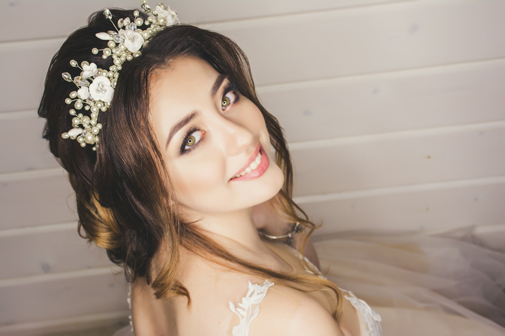

Zatímco šaty se vybírají měsíce dopředu, na účes se často myslí až na poslední chvíli. Přitom dobré kadeřnice mívají svatební sezónu obsazenou daleko dopředu.

## Časový plán

| Kdy | Co udělat |
| --- | --- |
| 6–9 měsíců předem | vybrat kadeřnici a zarezervovat termín |
| 3–4 měsíce předem | střih a případné barvení, ať vlasy stihnou dorůst do tvaru |
| 1–2 měsíce předem | zkouška účesu |
| 2–3 týdny předem | poslední úprava barvy |
| týden předem | zastřižení konečků, ne nový střih |

## Výběr kadeřnice

- **Podívejte se na ukázky svatebních účesů**, ne jen běžné práce.
- **Zjistěte, jestli dojíždí na místo.** Na svatbu se obvykle chystá doma nebo v místě obřadu.
- **Domluvte se na počtu účesů.** Pokud se chystá i maminka nebo družičky, kadeřnice musí počítat s časem.

## Zkouška účesu nevynechávejte

Na zkoušce se ukáže, jestli účes sedí k obličeji, šatům i závoji a jak dlouho vydrží. Přineste:

- **fotky účesů**, které se vám líbí,
- **fotku šatů** (hlavně výstřih a záda),
- **závoj, čelenku nebo ozdoby** do vlasů,
- triko, které jde svléknout přes hlavu bez poničení účesu.

Po zkoušce si účes nechte celý den a vyfoťte ho z různých úhlů. Uvidíte, jak drží a jak vypadá na fotkách.

## Účes podle šatů

- **Hluboký výstřih na zádech** vynikne s vyčesaným drdolem.
- **Šaty s krajkou u krku** se hodí k jednoduššímu účesu, aby nesoupeřily.
- **Šaty bez ramínek** dobře doplní rozpuštěné vlny nebo polovyčesaný účes.
- **Dlouhý závoj** potřebuje pevný základ v účesu, ke kterému se připne.

## V den svatby

1. **Vlasy umyjte večer předem**, pokud kadeřnice neřekne jinak. Úplně čisté vlasy hůř drží.
2. **Žádné nové přípravky** ani masky těsně před svatbou.
3. **Počítejte s časem.** Svatební účes trvá klidně hodinu a půl.
4. **Mějte po ruce sponky a lak** na případné opravy během dne.

[Najděte kadeřnictví ve svém okolí](/okoli/) a ověřte si termíny včas.
